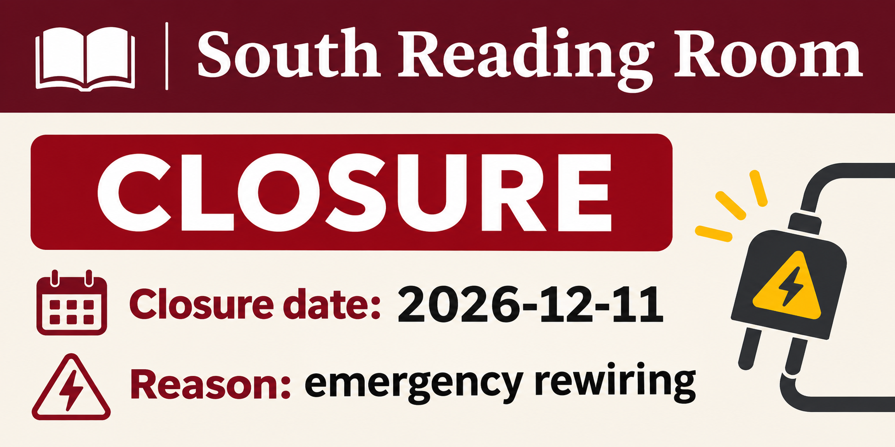

# 보너스 과제 수행 기록

## 1. 최종 프롬프트 재사용

도서관 휴실 공지 작성 업무에 다시 사용할 수 있도록 [시스템 설계 문서](../docs/system-design.md)의 최종 시스템 프롬프트 v2를 [rowan-agent/AGENTS.md](rowan-agent/AGENTS.md)에 원문 그대로 저장했다. Codex에서 해당 폴더를 작업 폴더로 열면 프로젝트 지침으로 사용할 수 있다.

2026-11-23에 Codex CLI 0.171.0에서 `bonus/rowan-agent`를 작업 디렉터리로 지정해 새 에이전트를 실행했다. 모델은 `gpt-6.1-terra`였다. 저장된 지침과 실행 결과는 아래에서 확인할 수 있다.

```text
codex exec --skip-git-repo-check -C . 'Draft the notice. Record: LB-18. Zone: South Reading Room. Closure date: 2026-12-11. Reason: emergency rewiring.'
```

응답 원문:

```text
Title: South Reading Room closure
Affected zone: South Reading Room
Closure date: 2026-12-11
Reason: emergency rewiring
```

네 줄 형식과 입력의 날짜·사유가 일치한다. 지침 파일은 위 링크에서 확인할 수 있지만 **배포 화면 캡처는 확보하지 못했다**. 따라서 화면 증거 요구사항은 아직 남아 있다. 실제 공지에 사용하기 전에는 원본 기록과 대조해야 한다.

## 2. 대화 응답을 이용한 이미지 생성

[실행 로그](../docs/run-log.md)의 v2 대화 D02에서 나온 AI 응답을 수정하거나 다른 지시를 추가하지 않고 이미지 생성 도구에 입력했다.

```text
South Reading Room closure
Closure date: 2026-12-11
Reason: emergency rewiring
```

생성된 이미지:



이미지에 표시된 구역, 휴실 날짜, 사유가 입력한 응답과 일치하는지 확인했다. 2026년 11월 23일 내장 이미지 생성 도구를 사용했으며, 모델의 세부 버전은 확인할 수 없었다. 공지에 나온 도서관과 운영 기록은 가상의 사례다.

## 3. API 키 없이 LLM API 호출

Google Apps Script 대신 터미널의 `curl`을 사용했다. 미션에서 다른 도구를 허용하며, 로그인이나 설치 과정 없이 실제 HTTP 응답을 확인하기 위해서다. Google 서비스 로그인은 이번 호출에 필요하지 않았다. [Code.gs](Code.gs)는 기존에 준비한 Apps Script 코드이며 키가 없으면 요청 전에 중단하므로 이번 호출에는 사용하지 않았다.

[시스템 설계 문서](../docs/system-design.md)의 **사용자 입력 · 텍스트 생성** D01을 수정하지 않고 요청 본문에 넣었다. Gemini API 키를 발급하거나 입력하지 않았고 인증 헤더도 보내지 않았다. 사용자가 유료 키를 제공하지 않기로 하여 발급을 시도하지 않은 것이며, 결제 수단 등록 때문에 발급이 거부된 것은 아니다.

2026-11-23 21:20:58 KST에 실행한 요청 (`gemini-2.5-flash`):

```sh
curl -sS -i -X POST 'https://generativelanguage.googleapis.com/v1beta/models/gemini-2.5-flash:generateContent' -H 'Content-Type: application/json' --data-binary @- <<'EOF'
{"contents":[{"parts":[{"text":"Draft the notice.\nRecord: LB-18\nZone: South Reading Room\nClosure date: 2026-12-08\nReason: lighting repairs\nInternal note: supplier quote pending"}]}]}
EOF
```

응답 본문 원문과 HTTP 상태:

```text
HTTP/2 403
{
  "error": {
    "code": 403,
    "message": "Permission denied on the service.",
    "status": "PERMISSION_DENIED",
    "details": [
      {
        "@type": "type.googleapis.com/google.rpc.ErrorInfo",
        "reason": "ACCESS_DENIED",
        "domain": "googleapis.com",
        "metadata": {
          "service": "generativelanguage.googleapis.com"
        }
      },
      {
        "@type": "type.googleapis.com/google.rpc.LocalizedMessage",
        "locale": "en-US",
        "message": "Permission denied on the service."
      }
    ]
  }
}
```

서버에서 접근이 거부되어 생성된 공지는 없다. 이번 실습에서는 유료 API 사용에 필요한 API 키가 없어 키를 넣지 못했고, 그 결과 인증 정보 없이 요청했다. 서버가 반환한 오류는 서비스 접근 권한 거부이며, 응답 자체에는 키 누락이 구체적인 원인이라고 명시되어 있지는 않다.
