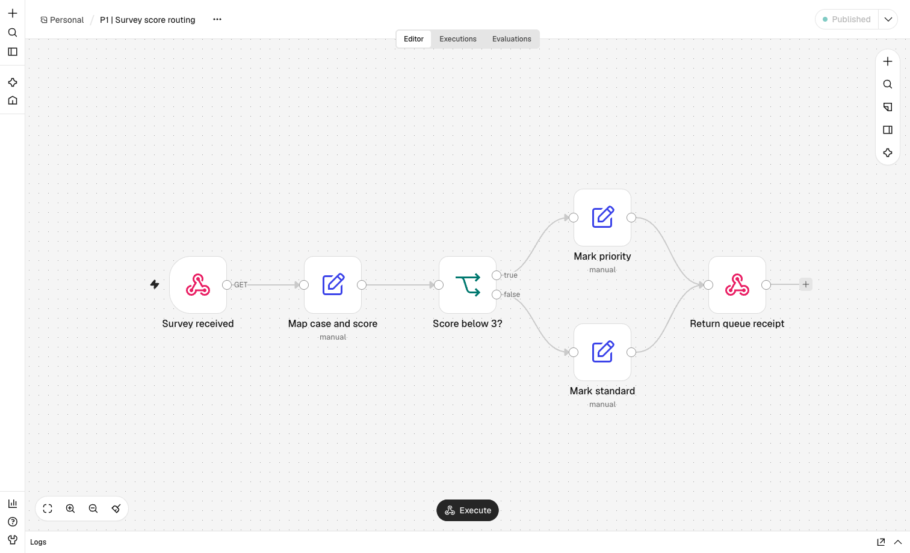
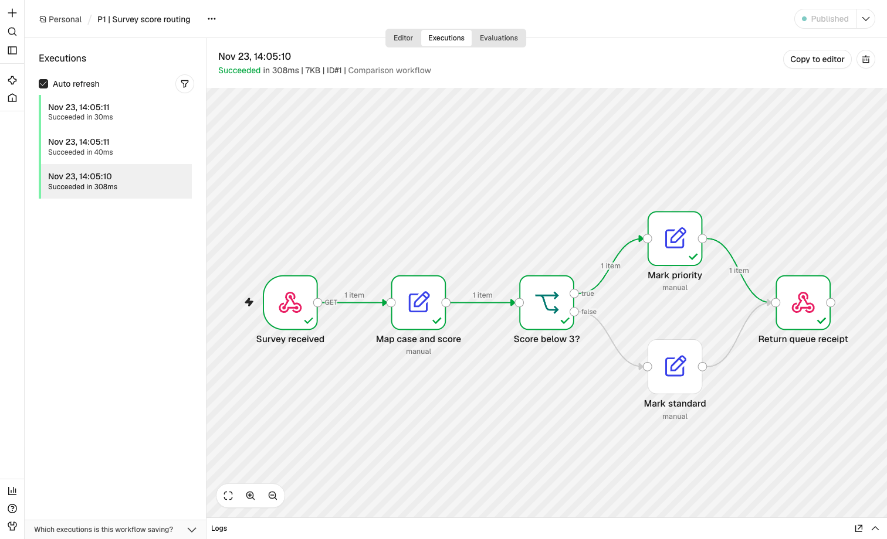
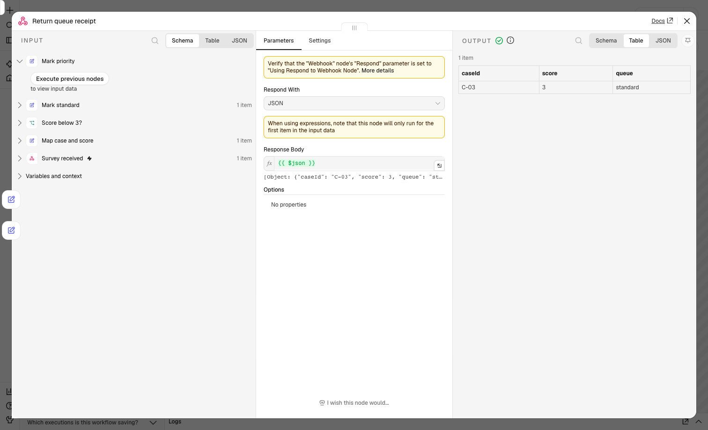
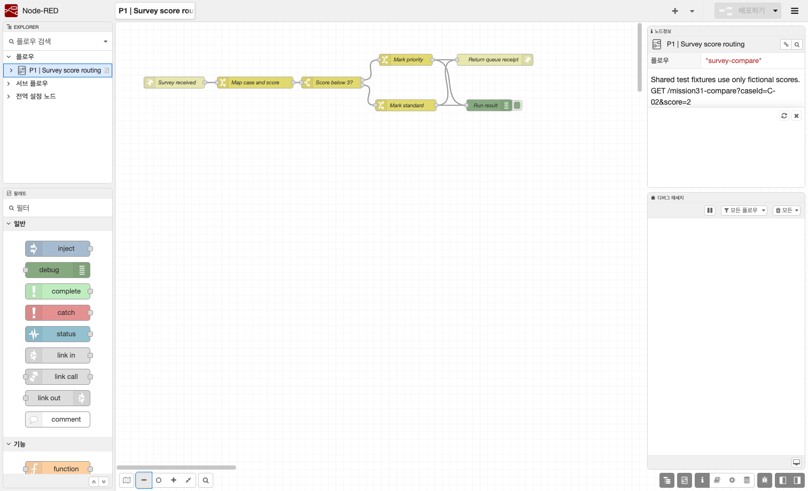
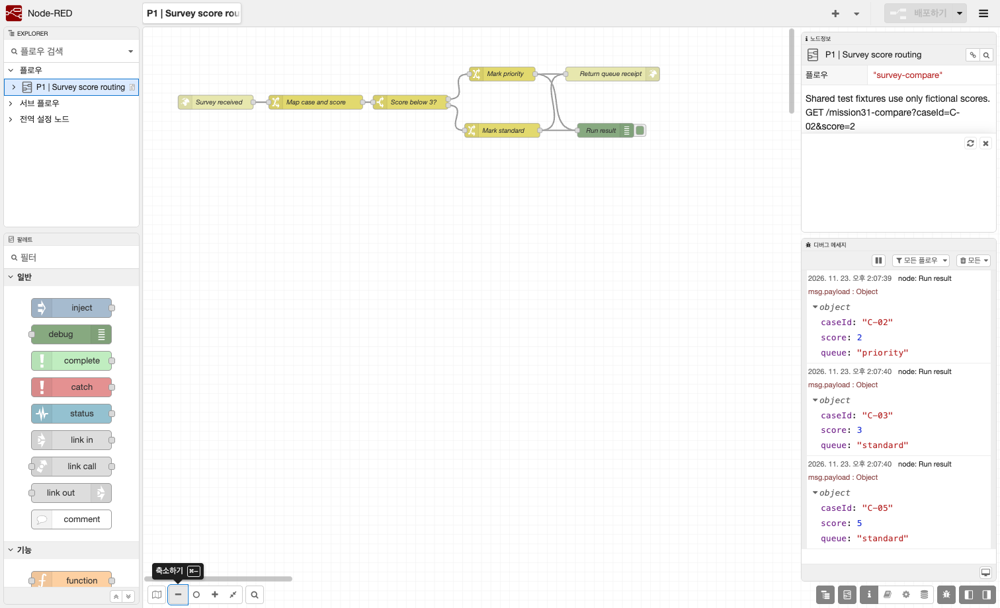

# 프로젝트 1 · 노코드 자동화 도구 비교

**실습 주제** — 모의 제품 설문 점수를 받아 우선 검토와 일반 검토로 나눈다.

## 비교할 업무

가상의 제품 설문 점수를 받아 우선 검토와 일반 검토로 나누는 흐름을 n8n과 Node-RED에 각각 만들었다. 두 도구에 같은 입력과 분기 조건을 적용하고 결과가 같은지 확인했다. 이후 비교 결과를 바탕으로 도구를 골라 AI 요약이 포함된 설문 접수 자동화를 구성했다.

## 동일하게 구현한 규칙

브라우저의 HTTP GET 요청이 웹훅에 도착하면 `caseId`와 `score`를 꺼낸다. 점수를 숫자로 변환한 뒤, 3점 미만이면 `priority`, 3점 이상이면 `standard`를 붙여 HTTP 200과 JSON 접수 결과를 반환한다. 비교용 입력 범위는 1~5의 정수다.

| 가상 접수 ID | 입력 점수 | 기대 대기열 | n8n 실제 | Node-RED 실제 |
| --- | ---: | --- | --- | --- |
| C-02 | 2 | `priority` | `priority` | `priority` |
| C-03 | 3 | `standard` | `standard` | `standard` |
| C-05 | 5 | `standard` | `standard` | `standard` |

여섯 응답 모두 HTTP 200이었다. 응답 본문의 접수 ID, 숫자 점수, 대기열이 대응하는 입력마다 같았다.

## 구현과 실행 증거

### n8n Community Edition 2.48.7

`Webhook` → `Edit Fields` → `If` → 경로별 `Edit Fields` → `Respond to Webhook` 순서로 연결했다. 게시된 운영 웹훅 URL에 세 점수를 보내고, 실행 목록과 자동으로 실행된 경로를 확인했다.

### Node-RED 5.0.10

`HTTP In` → `Change` → `Switch` → 경로별 `Change` → `HTTP Response` 순서로 연결했다. 각 경로 결과를 같은 `Debug` 노드에 연결한 뒤 배포하고, 브라우저에서 같은 세 점수를 보내 응답과 Debug 패널을 확인했다.

## 비교 분석

| 비교 항목 | n8n Community Edition | Node-RED |
| --- | --- | --- |
| 구성 화면 | 노드를 캔버스에 연결하고 노드 설정에서 입력과 출력을 확인한다. | 좌측 팔레트에서 노드를 가져오며, 흐름과 Debug 패널을 같은 편집 화면에 열 수 있다. |
| 트리거 등록 | Webhook의 테스트 URL과 운영 URL이 나뉜다. 운영 URL에는 게시가 필요하다. | HTTP In에 메서드와 경로를 정한 다음 Deploy로 등록한다. |
| 데이터 매핑 | Edit Fields에서 이름, 값, 자료형을 지정한다. 이전 노드의 값을 참조할 수 있다. | Change 노드에서 메시지의 속성을 바꾼다. 이 실습에서는 내장 JSONata 식으로 요청 값을 꺼내고 점수를 숫자로 변환했다. |
| 조건 분기 | If의 true와 false 출력으로 두 경로를 연결했다. | Switch의 첫 번째 규칙은 숫자 3 미만, 두 번째 규칙은 otherwise로 구성했다. |
| 결과 확인 | Executions에서 웹훅 요청별로 성공 상태와 실행된 노드를 다시 볼 수 있다. | Debug 노드가 받은 최종 메시지와 시각을 사이드바에서 확인한다. 비교 구성에서는 노드별 입력·출력이 자동으로 저장되는 실행 목록이 없다. |
| 자동화 확장 | Form Trigger와 Data Table 기본 노드가 있어 브라우저 설문 접수부터 저장까지 한 환경에서 구성할 수 있었다. | HTTP, 분기, 메시지 변환 블록을 조합하기 쉽다. 웹 폼과 지속 저장은 연결할 서비스를 추가로 선택해야 한다. |
| 무료 사용과 운영 | 로컬 Community Edition으로 트리거, 다단계 액션, If, Data Table을 사용했다. | 로컬 기본 배포에서 HTTP In, 다단계 액션, Switch와 Debug를 사용했다. |

n8n은 처리 근거를 건별로 다시 살펴볼 수 있어 설문·문의 대기열처럼 실행 내용을 검토하는 업무에 적합하다. 초기 소유자 계정을 만들고 웹훅을 게시하는 과정이 필요했다. Node-RED는 짧은 이벤트 흐름을 전체로 살피고 메시지 변환 결과를 바로 확인할 때 편하다. 실행을 장기 보관하려면 별도의 저장 단계를 설계해야 한다.

## 계정, 서비스 및 비용

| 도구 | 연결 계정 | 외부 서비스와 권한 |
| --- | --- | --- |
| n8n | 실습용 로컬 소유자 계정 `la***@example.invalid` | 프로젝트 1에는 연동 서비스와 OAuth 권한 없음. 브라우저가 루프백 웹훅을 호출했다. |
| Node-RED | 루프백에서 로컬 편집기로 접속, 별도 계정 없음 | 외부 서비스, OAuth 권한, API 키 없음. |

두 도구는 자체 호스팅 무료 범위에서 실행했다. 이 구성에 플랫폼의 월별 실행 크레딧은 없으며 처리량은 실행 호스트의 자원과 가동 시간에 좌우된다. 프로젝트 2의 생성형 AI도 로컬 Ollama를 호출해 결제나 공급자 API 키 없이 실행했다. 요금제와 기능 범위는 사용한 자체 호스팅 버전을 기준으로 한다.

실습 환경은 Docker로 실행하고, 워크플로우 설정 파일을 만들어 각 도구에 등록했다. 브라우저 자동화와 HTTP 요청으로 운영 URL을 실행하고 편집기와 실행 화면을 캡처했다. 비교용 설정 파일은 [n8n](workflows/n8n-comparison.json)과 [Node-RED](workflows/node-red-comparison.json)에서 확인할 수 있다.

## 참고 자료

- [n8n Community Edition 기능](https://docs.n8n.io/hosting/community-edition-features/)
- [n8n Webhook 설정](https://docs.n8n.io/integrations/builtin/core-nodes/n8n-nodes-base.webhook/)
- [Node-RED 기본 노드](https://nodered.org/docs/user-guide/nodes)
- [Node-RED Debug 사이드바](https://nodered.org/docs/user-guide/editor/sidebar/debug)
