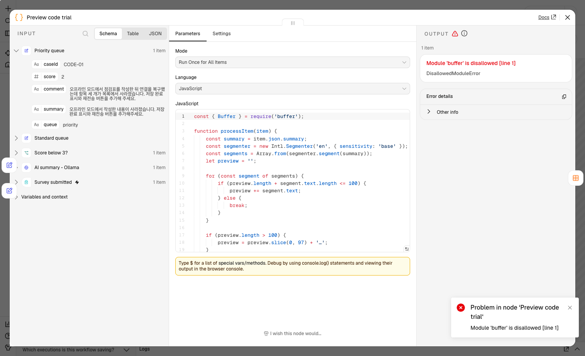

# 노코드 한계와 코드 적용 기록

설문 접수 흐름을 만든 뒤 추가로 필요할 수 있는 기능 세 가지를 살펴봤다. 아래 내용은 실습에 사용한 n8n Community Edition과 로컬 AI 모델을 기준으로 정리했다.

## 1. 티켓 미리보기를 100 UTF-8 바이트로 자르기

후속 티켓 시스템이 100 **바이트**까지만 받으며 끝에 말줄임표를 붙이는 상황을 가정했다. 한글과 조합 이모지는 화면에서 한 글자로 보여도 여러 바이트를 차지한다. Edit Fields로 문자열을 옮길 수 있지만, 남은 바이트 수를 계산하면서 글자가 중간에 잘리지 않도록 처리하는 설정 블록은 찾지 못했다. 요약 프롬프트에서 글자 수를 제한해도 바이트 상한을 확인할 수 없어 기본 흐름에서 이 기능을 제외했다.

## 2. 담당자별로 분리된 접수 관리 권한

우선·일반 대기열은 같은 표의 `queue` 값으로 구분한다. 두 담당자 그룹에 각각 자기 대기열만 보이고 수정되게 하는 권한을 고려했다. Data Table의 조건 필터는 노드가 처리할 행을 고르는 용도이며 담당자 계정에 대한 접근 정책을 만들지 못한다. 사용한 Community Edition에서는 팀 프로젝트 및 공유 기능이 제한되어 있어 이 권한 분리를 구현하지 않았다. [n8n Community Edition 기능 범위](https://docs.n8n.io/hosting/community-edition-features/)

## 3. 요약의 사실 일치 확률로 자동 검토 여부 결정

요약을 사람이 확인해야 할 확률을 계산해 위험한 건을 따로 보내는 기능을 고려했다. 사용한 Ollama 텍스트 생성 응답의 `response`는 요약문이다. 토큰 로그 확률을 제공하는 모델이라도 그 값은 설문 원문과 요약문이 사실상 일치할 확률을 직접 측정한 값이 아니다. If 노드는 이미 있는 값을 기준과 비교할 수 있지만, 사람이 확인한 결과를 바탕으로 신뢰할 수 있는 요약 품질 점수를 만들어 주지는 않는다. 이 실습의 분기는 제출자의 만족도에만 근거한다. [Ollama 생성 응답 필드](https://docs.ollama.com/api/generate)

## 코드 시도 · 100바이트 미리보기

### AI에 요청한 내용

Ollama `qwen2.5:7b`에 다음을 보냈다.

> Write only JavaScript for an n8n Code node in Run Once for All Items mode. A downstream ticket preview must be at most 100 UTF-8 bytes including the ellipsis if truncated and may not split a Unicode grapheme. Use Intl.Segmenter and Buffer.byteLength. Read item.json.summary; add item.json.preview; preserve all item fields, return items. No dependencies and no Markdown.

### 받은 코드

모델이 코드 블록을 반환했다. 붙여 넣을 때 Markdown 코드 표시만 제거했다.

```javascript
const { Buffer } = require('buffer');

function processItem(item) {
    const summary = item.json.summary;
    const segmenter = new Intl.Segmenter('en', { sensitivity: 'base' });
    const segments = Array.from(segmenter.segment(summary));
    let preview = '';

    for (const segment of segments) {
        if (preview.length + segment.text.length <= 100) {
            preview += segment.text;
        } else {
            break;
        }
    }

    if (preview.length > 100) {
        preview = preview.slice(0, 97) + '…';
    }

    item.json.preview = preview;
    return item;
}

module.exports = processItem;
```

### 코드를 넣은 위치

운영 설문 워크플로우의 복제본을 만들었다. 두 분기의 `Edit Fields`에서 나온 `summary`가 저장으로 넘어가기 직전에 `Preview code trial`이라는 Code 노드를 추가했다. 모드는 **Run Once for All Items**로 설정하고 JavaScript 입력란에 AI가 준 코드를 붙였다. 복제본의 별도 운영 폼에 가상 접수 `CODE-01`을 제출했다.

### 붙여 본 결과

실행 #10은 Code 노드 첫 줄에서 `Module 'buffer' is disallowed [line 1]` 오류로 멈췄다. 요약 액션과 우선 분기까지는 실행됐으며 미리보기 생성과 표 저장은 실행되지 않았다. 코드의 `preview.length` 또한 요구한 UTF-8 바이트 계산을 하지 않는다. 실행 환경의 모듈 허용 범위를 바꾸지 않았으며, 실험이 끝난 복제본을 게시 해제했다.


